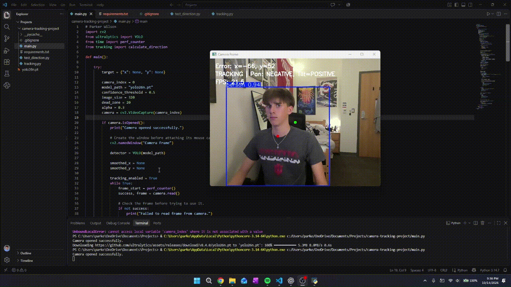

# Python Person Tracking Software (Webcam-Based)

## Contributions
Uses pretrained YOLO for person detections. I implemented target-coordinate processing, smoothening of detection, movement-direction logic, pause/resume controls, and the OpenCV interface.

## My Decisions and Explanations
- Orginally was going to use HOG detection for this project, but soon decided that it was unreliable and not to my liking regarding the framerate on a windows machine. This led me to use YOLO instead, which gave much better results and a more cleaner output.
- Also reducing interface size to 320, increased observing processing rate from about 12 FPS to roughly 30 FPS for better optimization.
- Smoothing reduced target jitter by about 40%.
- A dead zone prevents constant movement in the center of webcam (for later projects).

## Testing and Diagnoising
- Used a separate Python script to test directional movement with the script w/o needing to open system's webcam.
- Smoothening was done via testing. This included standing still, movement left to right, and arm movements in a full 180°.
- Body detection still occurring without someone in frame. Was fixed by create if statement for detection / smoothening.

## Features
- Person detection, target smoothing, dead-zoning, direction display, FPS, and pause/resume keystrokes.

# Installation / Guide
1. `python -m pip install -r requirements.txt`
2. `python main.py`
- **Controls:** Space pauses/resumes; q quits while the video window is selected.
- **Testing:** python test_direction.py

# Limitations / Performance (10/14/26)
- Selects the first detected person, may switch between people, and currently displays commands without controlling motors.
- Approximately 20–30 FPS on your laptop at imgsz=320, measured before display. Treat this as your observed result, not a guarantee.
- YOLO performs detection; I built the application around it, including target processing and movement logic.
